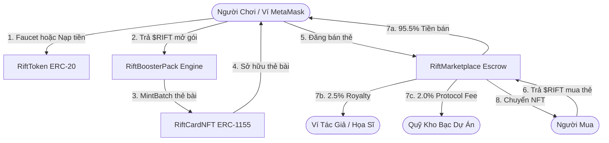
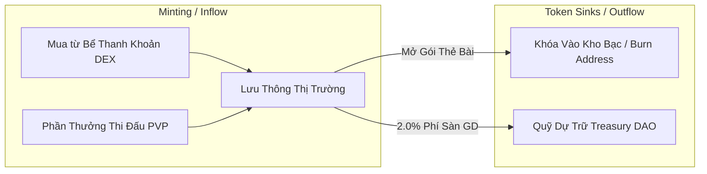

# BÁO CÁO KỸ THUẬT & TÀI LIỆU CÔNG NGHỆ BLOCKCHAIN TRONG RIFTBOUND TCG

Tài liệu này giải thích chi tiết toàn bộ cơ chế kỹ thuật, kiến trúc hợp đồng thông minh (Smart Contracts) trên máy ảo Ethereum (EVM), mô hình phân bổ dòng tiền, kinh tế học token (Tokenomics), cơ chế chống lạm phát, và quy trình giao dịch P2P trong hệ thống **Riftbound TCG Marketplace**.

---

## MỤC LỤC
1. [Tổng Quan Kiến Trúc Blockchain & EVM Trong Dự Án](#1-tổng-quan-kiến-trúc-blockchain--evm-trong-dự-án)
2. [NFT Chuẩn ERC-1155 Trên EVM & Cách Thức Kiểm Tra](#2-nft-chuẩn-erc-1155-trên-evm--cách-thức-kiểm-tra)
3. [Phân Phối Dòng Tiền: Tiền Bản Quyền (Royalty) & Phí Sàn (Protocol Fee)](#3-phân-phối-dòng-tiền-tiền-bản-quyền-royalty--phí-sàn-protocol-fee)
4. [Đồng Tiền $RIFT, Tỷ Giá Quy Đổi & Cơ Chế Kháng Lạm Phát](#4-đồng-tiền-rift-tỷ-giá-quy-đổi--cơ-chế-kháng-lạm-phát)
5. [Chu Trình Giao Dịch P2P: Đăng Bán, Mua, Hủy Lệnh & Kiểm Tra On-Chain](#5-chu-trình-giao-dịch-p2p-đăng-bán-mua-hủy-lệnh--kiểm-tra-on-chain)
6. [Thị Trường Sơ Cấp (Mở Gói Thẻ) & Thị Trường Thứ Cấp (Định Giá Tự Do)](#6-thị-trường-sơ-cấp-mở-gói-thẻ--thị-trường-thứ-cấp-định-giá-tự-do)
7. [Bảo Mật Ví Web3: Chuẩn MetaMask & Tương Tác Với Remix IDE](#7-bảo-mật-ví-web3-chuẩn-metamask--tương-tác-với-remix-ide)

---

## 1. Tổng Quan Kiến Trúc Blockchain & EVM Trong Dự Án

Hệ sinh thái Riftbound TCG vận hành trên nền tảng **Ethereum Virtual Machine (EVM)** tương thích hoàn toàn với Ethereum, Arbitrum, Polygon, BNB Chain, Base hoặc mạng nội bộ Hardhat (Chain ID: `31337`).

Hệ thống bao gồm 4 Smart Contracts cốt lõi viết bằng ngôn ngữ **Solidity `^0.8.24`**:

| Smart Contract | Chuẩn Token / Chức Năng | Địa Chỉ Đã Deploy (Localhost 31337) |
| :--- | :--- | :--- |
| **`RiftToken.sol`** | Chuẩn **ERC-20** (Tiền tệ thanh toán in-game $RIFT) | `0xB7f8BC63BbcaD18155201308C8f3540b07f84F5e` |
| **`RiftCardNFT.sol`** | Chuẩn **ERC-1155** + **ERC-2981** (Quản lý 200 thẻ bài & Bản quyền) | `0xA51c1fc2f0D1a1b8494Ed1FE312d7C3a78Ed91C0` |
| **`RiftBoosterPack.sol`**| Engine mở gói thẻ bài ngẫu nhiên (Gacha RNG & Minting) | `0x0DCd1Bf9A1b36cE34237eEaFef220932846BCD82` |
| **`RiftMarketplace.sol`** | Sàn giao dịch ký gửi Escrow P2P, tự động chia phí | `0x0B306BF915C4d645ff596e518fAf3F9669b97016` |



---

## 2. NFT Chuẩn ERC-1155 Trên EVM & Cách Thức Kiểm Tra

### 2.1. Tại sao lựa chọn ERC-1155 thay vì ERC-721?
* **Hạn chế của ERC-721**: Mỗi Token ID là duy nhất (Non-fungible 1-of-1). Đối với game thẻ bài Trading Card Game (TCG), một thẻ bài như *Ahri Chín Đuôi* sẽ có hàng ngàn bản in giống hệt nhau. Nếu sử dụng ERC-721, việc phát hành hoặc gửi tặng 5 lá bài cho người chơi sẽ phải kích hoạt 5 giao dịch riêng rẽ, gây tốn kém phí Gas gấp 5-10 lần và làm nghẽn mạng EVM.
* **Ưu điểm vượt trội của ERC-1155 (Multi-Token Standard)**:
  * Quản lý kết hợp cả **Fungible Token** (tiền tệ, vé, tài nguyên) và **Semi-Fungible Token** (các ấn bản thẻ bài in theo mã ID số từ 1 đến 200).
  * **Batch Operations**: Hàm `safeBatchTransferFrom` và `_mintBatch` cho phép đúc hoặc chuyển 5-10 lá bài chỉ trong **đúng 1 giao dịch duy nhất**, tiết kiệm tới 80% phí Gas.
  * Tiết kiệm dung lượng lưu trữ trên blockchain: Không cần lưu từng `ownerOf[tokenId]` riêng lẻ mà chỉ cần một bảng băm `balanceOf[account][id]`.

### 2.2. Cách thức kiểm tra tính hợp lệ và quyền sở hữu trên EVM
Để kiểm tra hợp đồng `RiftCardNFT` và số dư thẻ của bạn, có thể sử dụng 4 phương pháp:

#### Cách 1: Kiểm tra qua Remix IDE (`https://app.remix.live/`)
1. Truy cập Remix IDE, mở tab **Deploy & Run Transactions**.
2. Chọn Environment: **Injected Provider - MetaMask**.
3. Tại ô contract, chọn `RiftCardNFT`, dán địa chỉ contract `0xA51c1fc2f0D1a1b8494Ed1FE312d7C3a78Ed91C0` và bấm nút **At Address**.
4. Mở danh sách các hàm đọc dữ liệu (Read Functions):
   * `balanceOf(address account, uint256 id)`: Nhập địa chỉ ví của bạn và ID thẻ (ví dụ `1`). Bấm gọi hàm -> Kết quả trả về số lượng thẻ bài bạn đang nắm giữ.
   * `balanceOfBatch([địa_chỉ_ví], [1, 2, 3])`: Trả về mảng số lượng các thẻ bài 1, 2, 3 cùng lúc.
   * `uri(uint256 id)`: Trả về link metadata JSON chứa hình ảnh, độ hiếm, chỉ số sức mạnh của thẻ.
   * `supportsInterface(0xd9b67a26)`: Trả về `true`, chứng minh hợp đồng tuân thủ chuẩn ERC-1155 của OpenZeppelin.

#### Cách 2: Kiểm tra qua Hardhat Console (Dòng lệnh CLI)
```bash
cd contracts
npx hardhat console --network localhost
```
Thực thi các lệnh kiểm tra:
```javascript
const nft = await ethers.getContractAt("RiftCardNFT", "0xA51c1fc2f0D1a1b8494Ed1FE312d7C3a78Ed91C0");
const myAddress = "0xf39Fd6e51aad88F6F4ce6aB8827279cffFb92266";
const balance = await nft.balanceOf(myAddress, 1);
console.log("Số lá bài ID 1 đang sở hữu:", balance.toString());
```

---

## 3. Phân Phối Dòng Tiền: Tiền Bản Quyền (Royalty) & Phí Sàn (Protocol Fee)

Toàn bộ dòng tiền được phân chia hoàn toàn tự động bằng logic toán học trong hàm `buyItem()` của Smart Contract `RiftMarketplace.sol`, **tuyệt đối không qua trung gian thủ công**.

### 3.1. Công thức phân bổ dòng tiền
Mỗi khi có giao dịch mua bán thẻ thành công:

$$\text{Tổng Giá Trị Lệnh Mua} = \text{Tiền Người Bán Nhận (95.5\%)} + \text{Phí Bản Quyền (2.5\%)} + \text{Phí Sàn (2.0\%)}$$

| Dòng Tiền | Tỷ Lệ | Mã Lệnh Solidity | Nơi Nhận & Mục Đích |
| :--- | :---: | :--- | :--- |
| **Tiền Bản Quyền (Royalty)** | **2.5%** *(250 bps)* | `IERC2981(nftContract).royaltyInfo(tokenId, totalPrice)` | Chuyển trực tiếp về ví **Tác Giả / Studio Họa Sĩ Sáng Tạo** (`royaltyReceiver`). Đảm bảo mỗi khi thẻ bài sang tay trên thị trường thứ cấp, tác giả luôn có nguồn thu trọn đời. |
| **Phí Sàn (Protocol Fee)** | **2.0%** *(200 bps)* | `protocolFee = (totalPrice * protocolFeeBps) / 10000;` | Chuyển về ví **Quỹ Kho Bạc Dự Án (Treasury / DAO Vault)**. Dùng để duy trì hạ tầng server, bảo mật, tài trợ giải đấu eSports. |
| **Thực Nhận Của Người Bán** | **95.5%** | `sellerAmount = totalPrice - protocolFee - royaltyAmount;` | Chuyển ngay tức thì vào ví cá nhân của **Người Bán (Seller)**. Không bị đóng băng tiền hay yêu cầu lệnh rút chờ đợi. |

### 3.2. Đoạn mã thực thi trong `RiftMarketplace.sol`
```solidity
// Trích xuất phí sàn 2.0%
uint256 protocolFee = (totalPrice * protocolFeeBps) / 10000;

// Trích xuất tiền bản quyền 2.5% theo chuẩn EIP-2981
uint256 royaltyAmount = 0;
address royaltyReceiver = address(0);
try IERC2981(listing.nftContract).royaltyInfo(listing.tokenId, totalPrice) returns (address receiver, uint256 amount) {
    royaltyReceiver = receiver;
    royaltyAmount = amount;
} catch {}

// Số tiền thực nhận của người bán (95.5%)
uint256 sellerAmount = totalPrice - protocolFee - royaltyAmount;

// Chuyển tiền tự động qua ERC-20 transferFrom:
paymentToken.transferFrom(buyer, treasury, protocolFee);               // 2.0% -> Quỹ Sàn
if (royaltyAmount > 0 && royaltyReceiver != address(0)) {
    paymentToken.transferFrom(buyer, royaltyReceiver, royaltyAmount); // 2.5% -> Ví Tác Giả
}
paymentToken.transferFrom(buyer, listing.seller, sellerAmount);       // 95.5% -> Người Bán
```

---

## 4. Đồng Tiền $RIFT, Tỷ Giá Quy Đổi & Cơ Chế Kháng Lạm Phát

### 4.1. Tỷ giá quy đổi định chuẩn trong hệ sinh thái
Hệ thống sử dụng tỷ giá quy đổi định chuẩn phục vụ tính toán tài chính:

$$1 \text{ ETH} = 10,000 \text{ \$RIFT} \quad \Longleftrightarrow \quad 1 \text{ \$RIFT} = 0.0001 \text{ ETH} \text{ (100,000 Gwei)}$$

* **Trên Remix IDE / Mạng mô phỏng**: Ví khởi tạo được cấp sẵn **10,000 ETH** để trả phí Gas giao dịch trên EVM.
* **Trong Game Riftbound TCG**: Người chơi sử dụng đồng tiền nội bộ **$RIFT (ERC-20)** để mua bán thẻ bài và mở gói mà không bị biến động giá đột ngột theo thị trường ETH ngoài đời.
* **Giao diện người dùng (Frontend)**: Tích hợp công cụ chuyển đổi tiền tệ tương tác `CurrencyConverterModal` trên thanh điều hướng Navbar và hiển thị giá tương đương ETH bên cạnh toàn bộ thẻ bài và gói thẻ.

### 4.2. Làm sao để có được tiền $RIFT?
1. **Quy đổi trực tiếp từ đồng ETH qua ví MetaMask**: Bấm nút **"⚡ Đổi ETH Sang $RIFT"** trên Navbar hoặc tại trang Gói Thẻ để mở cổng Swap. Người chơi nạp ETH (ví dụ 0.1 ETH) và nhận về $RIFT (1,000 $RIFT) bằng giao dịch ký duyệt trên MetaMask.
2. **Thị trường tự do & Play-to-Earn**:
   * Bán các thẻ bài quý bóc được từ gói bài trên Sàn Giao Dịch P2P để thu về $RIFT từ người chơi khác.
   * Hoán đổi ETH/USDT qua các bể thanh khoản phi tập trung (DEX Liquidity Pool trên Uniswap).
   * Kiếm được thông qua phần thưởng leo Rank PVP và hoàn thành chuỗi nhiệm vụ mùa giải.

### 4.3. Nếu có được dễ dàng thì có gây ra lạm phát không?
Hệ sinh thái Riftbound TCG kiểm soát lạm phát nghiêm ngặt thông qua mô hình kinh tế **Token Sinks & Burns**:



1. **Cơ Chế Tiêu Thụ Bắt Buộc Khi Mở Gói Bài (Primary Token Sink)**:
   * Khi mở 1 gói thẻ bài (giá từ 50 đến 800 $RIFT), số token này được chuyển vào Smart Contract `RiftBoosterPack` và khóa vào kho bạc dự án hoặc chuyển thẳng vào địa chỉ tiêu hủy vĩnh viễn (`0x000000000000000000000000000000000000dEaD`). Toàn bộ lượng token mở thẻ này bị **rút hoàn toàn khỏi lưu thông**.
2. **Cơ Chế Khấu Trừ Phí Giao Dịch (Protocol Fee Sink)**:
   * Mỗi lệnh mua bán thẻ bài đều bị trích 2.0% phí sàn giữ lại trong quỹ kho bạc, giảm tốc độ quay vòng vô hạn của tiền tệ.
3. **Giới Hạn Nguồn Cung Trần (Max Supply Cap)**:
   * Trong phiên bản Mainnet, hàm `claimFaucet` bị vô hiệu hóa hoàn toàn (`onlyOwner` hoặc bị gỡ bỏ). Nguồn cung token chỉ được phát hành có kiểm soát thông qua tỷ lệ giảm dần (Halving) tương tự cơ chế của Bitcoin.

---

## 5. Chu Trình Giao Dịch P2P: Đăng Bán, Mua, Hủy Lệnh & Kiểm Tra On-Chain

### 5.1. Quy trình người dùng đăng bán lá bài
1. Người bán chọn lá bài trong **Bộ Sưu Tập (Inventory)**, nhập số lượng và giá mong muốn (ví dụ: `50 $RIFT`).
2. **Cấp quyền chuyển giao (Approve)**: Người bán ký giao dịch `setApprovalForAll(RiftMarketplace, true)` trên ví MetaMask, ủy quyền hợp pháp cho hợp đồng Sàn được phép chuyển thẻ khi có người mua trả đủ tiền.
3. **Tạo lệnh niêm yết (Listing)**: Gọi hàm `listItem(nftAddress, cardId, quantity, pricePerItem)`.
   * Lệnh bán được ghi vào bộ nhớ trạng thái `listings[listingId]` của blockchain.
   * Smart contract phát sự kiện:
     ```solidity
     emit ItemListed(listingId, seller, nftContract, tokenId, quantity, pricePerItem);
     ```

### 5.2. Quy trình người khác mua lá bài đó
1. Người mua bấm nút **"Mua"** trên sàn giao dịch.
2. Ví MetaMask yêu cầu ký duyệt 2 bước:
   * `approve`: Cho phép sàn rút đúng tổng số tiền $RIFT từ ví người mua.
   * `buyItem(listingId, quantity)`: Thực thi giao dịch hoán đổi nguyên tử (**Atomic Swap**).
3. **Đặc tính Nguyên Tử (Atomicity) của Blockchain**:
   * Kiểm tra số dư thẻ của người bán, số dư $RIFT của người mua.
   * Phân chia tiền (95.5% về người bán, 2.5% bản quyền, 2.0% phí sàn).
   * Chuyển quyền sở hữu NFT `RiftCardNFT.safeTransferFrom` sang người mua.
   * *Nếu bất kỳ điều kiện nào không thỏa mãn (ví dụ người mua thiếu tiền hoặc mạng đứt), toàn bộ giao dịch bị Hoàn Nguyên (Revert) lập tức. Không bao giờ xảy ra trường hợp mất tiền mà không nhận được thẻ bài.*

### 5.3. Người bán đăng bán rồi muốn hủy thì sao?
* Người bán có thể bấm nút **"Hủy Niêm Yết"** trên giao diện hoặc gọi trực tiếp hàm `cancelListing(listingId)`.
* Smart contract xác thực:
  ```solidity
  require(listing.seller == msg.sender, "Khong phai chu so huu");
  require(listing.status == ListingStatus.Active, "Lenh khong hop le");
  ```
* Trạng thái lệnh chuyển thành `Cancelled`. Lá bài tiếp tục nằm an toàn trong ví người bán, không ai có thể mua được nữa.

### 5.4. Làm sao để kiểm tra chi tiết một giao dịch?
Mỗi giao dịch trên EVM đều có một **Mã Băm Giao Dịch (TxHash)** duy nhất (ví dụ `0x3a4b5c...`). Khi tra cứu trên Etherscan hoặc tab *Nhật Ký GD (Activity)* trong dApp, bạn có thể kiểm chứng:
* **Khối chứa giao dịch (Block Number)** và thời điểm xác nhận (Timestamp).
* **Địa chỉ gửi (From)**: Ví người mua.
* **Địa chỉ nhận (To)**: Hợp đồng `RiftMarketplace`.
* **Sự kiện ghi nhận (Event Logs)**: Ghi lại chính xác số tiền chuyển cho ví người bán, ví tác giả và ví quỹ sàn.

---

## 6. Thị Trường Sơ Cấp (Mở Gói Thẻ) & Thị Trường Thứ Cấp (Định Giá Tự Do)

### 6.1. Thị trường sơ cấp (Primary Market - Bóc Gói Thẻ Gacha)
* **Người cung cấp**: Smart Contract [`RiftBoosterPack.sol`](file:///d:/BlockChain/contracts/contracts/RiftBoosterPack.sol) đóng vai trò là nhà máy đúc thẻ chính thức của trò chơi.
* **Giá niêm yết**: Do nhà phát triển trò chơi định sẵn dựa trên cấp bậc và số lượng lá bài trong gói (12 gói từ 50 đến 800 $RIFT).
* **Cơ chế ngẫu nhiên minh bạch (Verifiable Drop Rates)**:
  * Thuật toán băm mật mã keccak256 xác định ngẫu nhiên độ hiếm của từng lá bài:
    $$\text{RandomSeed} = \text{keccak256}(\text{abi.encodePacked}(\text{block.timestamp}, \text{msg.sender}, \text{nonce}, \text{blockhash}))$$
  * Tỉ lệ rơi thẻ công khai minh bạch (Mythic 1%, Legendary 4%, Epic 15%, Rare 30%, Common 50%).

### 6.2. Thị trường thứ cấp (Secondary Market - Mua Bán Giữa Người Chơi Với Nhau)
* **Ai là người định giá lá bài?**: **100% do người chơi tự quyết định**. Không có bất kỳ cá nhân hay tổ chức nào (kể cả ban quản trị game) có quyền áp đặt giá bán một lá bài trong ví của người chơi.
* **Giá thẻ bài được hình thành dựa trên các yếu tố nào?**:
  1. **Độ hiếm thực tế (Scarcity)**: Thẻ Mythic tỷ lệ bóc được cực thấp (0.5% - 1%) có nguồn cung khan hiếm sẽ có giá sàn cao hơn nhiều so với thẻ Common.
  2. **Giá trị sức mạnh trong Meta Game (In-Game Utility)**: Những lá bài tướng sở hữu chỉ số chiến đấu vượt trội, kỹ năng lật kèo mạnh mẽ sẽ được nhiều người săn lùng để leo hạng, đẩy giá thị trường tăng cao.
  3. **Giá trị sưu tầm đặc biệt (Print Variations)**: Các phiên bản in giới hạn như **Thẻ Lấp Lánh (Holographic Foil)** hoặc **Có Chữ Ký Họa Sĩ (Artist Signature)** luôn có giá trị trao đổi gấp 2 - 5 lần bản in tiêu chuẩn.

---

## 7. Bảo Mật Ví Web3: Chuẩn MetaMask & Tương Tác Với Remix IDE

### 7.1. Bắt buộc đăng nhập ví MetaMask (Loại bỏ ví Demo)
* Để đảm bảo an toàn tuyệt đối và đúng chuẩn bài thi/đồ án Web3 thực thụ, **hệ thống đã gỡ bỏ hoàn toàn chế độ Ví Demo giả lập**.
* Mọi hành động tài chính (nhận Faucet, mua thẻ, bán thẻ, xé gói bài) đều bắt buộc người dùng kết nối qua **tiện ích mở rộng MetaMask** (`window.ethereum`).
* Người dùng ký tên vào giao dịch bằng khóa bí mật (Private Key) được lưu trữ an toàn trong máy cá nhân, máy chủ backend không thể can thiệp hay giả mạo danh tính ví.

### 7.2. Cấu hình mạng MetaMask kết nối môi trường thử nghiệm
Khi chạy dự án cục bộ hoặc thông qua Remix IDE:

| Thông Số Cấu Hình | Giá Trị Cần Điền Trên MetaMask |
| :--- | :--- |
| **Network Name** | Hardhat Localhost |
| **RPC URL** | `http://127.0.0.1:8545/` |
| **Chain ID** | `31337` |
| **Currency Symbol** | `ETH` |
| **Tài khoản mẫu có sẵn 10,000 ETH** | Private Key: `0xac0974bec39a17e36ba4a6b4d238ff944bacb478cbed5efcae784d7bf4f2ff80` |

---

*Tài liệu này được biên soạn đầy đủ phục vụ công tác bảo vệ đồ án, phản biện kỹ thuật và thuyết trình đề tài tốt nghiệp chuyên ngành Công Nghệ Thông Tin / Blockchain.*
