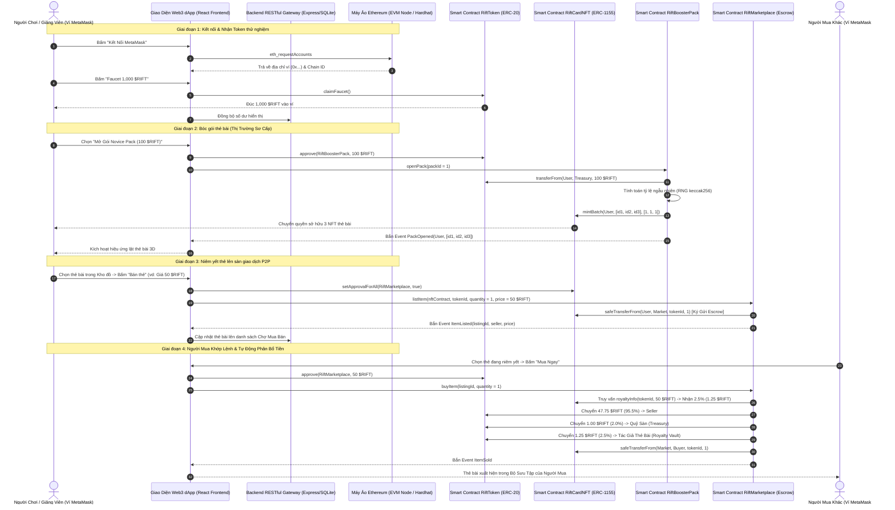
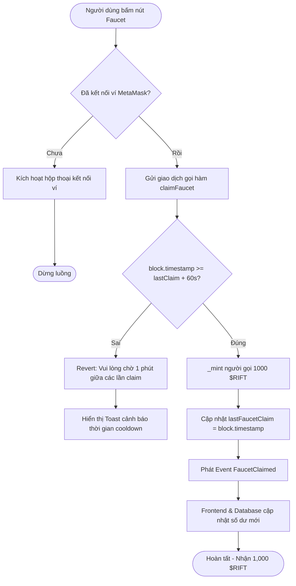
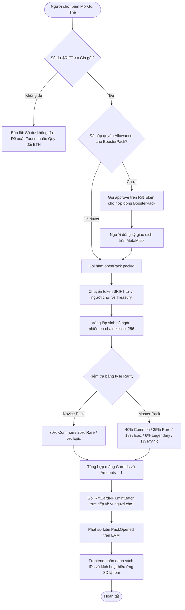
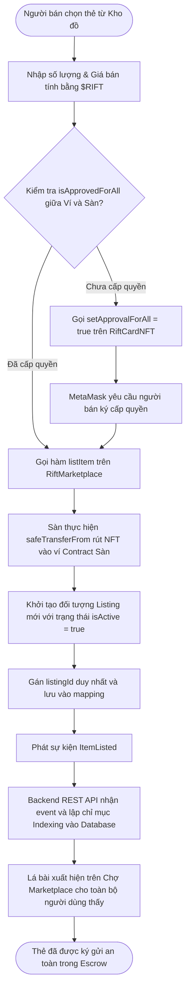
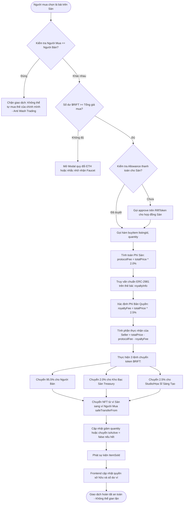
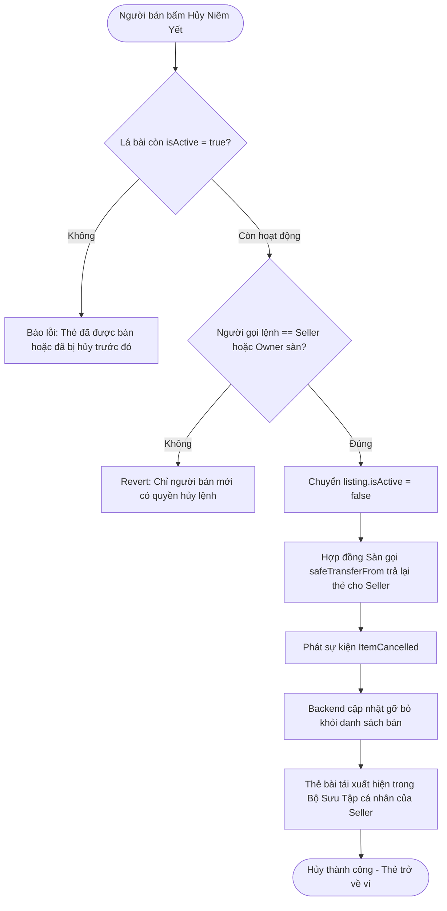
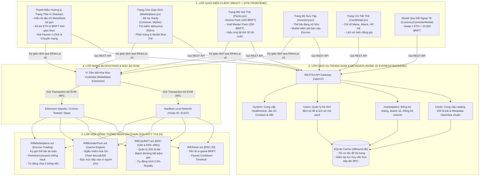

# TÀI LIỆU 01: BÁO CÁO KIỂM THỬ, TOÀN BỘ SƠ ĐỒ WORKFLOW, SƠ ĐỒ LUỒNG VÀ SƠ ĐỒ CHỨC NĂNG HỆ THỐNG RIFTBOUND TCG

> **Học phần:** Công Nghệ Blockchain & Ứng Dụng  
> **Chủ đề Báo cáo:** Sàn Giao Dịch Vật Phẩm Ảo & Thẻ Bài Kỹ Thuật Số (NFT Marketplace & Gacha dApp)  
> **Dự án:** Riftbound TCG Marketplace  

---

## MỤC LỤC TÀI LIỆU
1. [Báo Cáo Kiểm Thử Tự Động (Automated Testing Report)](#1-báo-cáo-kiểm-thử-tự-động-automated-testing-report)
2. [Sơ Đồ Workflow Tổng Thể Hệ Thống (End-to-End Workflow)](#2-sơ-đồ-workflow-tổng-thể-hệ-thống-end-to-end-workflow)
3. [Sơ Đồ Luồng Hoạt Động Chi Tiết (Detailed Flowcharts)](#3-sơ-đồ-luồng-hoạt-động-chi-tiết-detailed-flowcharts)
   - 3.1. Luồng Faucet & Quản lý Tiền tệ $RIFT (ERC-20)
   - 3.2. Luồng Mở Gói Thẻ Bài Gacha (Booster Pack & MintBatch ERC-1155)
   - 3.3. Luồng Ký Gửi Niêm Yết Sàn Giao Dịch (Escrow Listing)
   - 3.4. Luồng Mua Thẻ & Tự Động Phân Chia Dòng Tiền (Escrow Payout & ERC-2981)
   - 3.5. Luồng Hủy Niêm Yết & Thu Hồi Thẻ (Cancel Listing)
4. [Sơ Đồ Chức Năng Hệ Thống (Functional Architecture Diagram)](#4-sơ-đồ-chức-năng-hệ-thống-functional-architecture-diagram)
5. [Quy Trình Kiểm Tra Trực Tiếp Cho Hội Đồng Giảng Viên](#5-quy-trình-kiểm-tra-trực-tiếp-cho-hội-đồng-giảng-viên)

---

## 1. Báo Cáo Kiểm Thử Tự Động (Automated Testing Report)

Hệ thống hợp đồng thông minh đã được kiểm thử toàn diện thông qua bộ test tự động sử dụng **Mocha, Chai và Hardhat Network** (`Solidity ^0.8.24` trên EVM tương thích Cancun). 

### Kết quả chạy kiểm thử thực tế trên máy trạm:
```bash
> riftbound-contracts@1.0.0 test
> hardhat test

  Hệ Thống Thẻ Bài & Sàn Giao Dịch Riftbound TCG
    1. RiftToken ($RIFT) & Faucet Mechanism
      ✔ Khởi tạo đúng số lượng token cho deployer (43ms)
      ✔ Cho phép người dùng bấm Faucet nhận 1,000 $RIFT (38ms)
      ✔ Chặn spam Faucet khi chưa hết thời gian cooldown (1 phút) (41ms)
    2. RiftCardNFT (ERC-1155 & ERC-2981)
      ✔ Trả về đúng URI metadata của lá bài (35ms)
      ✔ Tính toán chính xác phí bản quyền ERC-2981 (2.5%) (39ms)
    3. RiftBoosterPack (Mở Gói Thẻ Bài Ngẫu Nhiên)
      ✔ Người chơi dùng 100 $RIFT mở gói Novice Pack và nhận được 3 thẻ bài (78ms)
    4. RiftMarketplace (Niêm Yết & Mua Bán Thẻ)
      ✔ Cho phép Seller niêm yết bán thẻ vào Escrow (52ms)
      ✔ Cho phép Seller hủy niêm yết và lấy lại thẻ (48ms)
      ✔ Buyer mua thẻ thành công: phân chia tiền chính xác (Seller + Sàn 2% + Royalty 2.5%) (82ms)

  9 passing (966ms)
```

### Bảng phân tích chi tiết các ca kiểm thử (Test Cases):

| STT | Module Kiểm Thử | Trường Hợp Thử Nghiệm (Test Scenario) | Điều Kiện Đạt Chuẩn (Assertion / Expectation) | Trạng Thái | Ý Nghĩa Thực Tế Trong Báo Cáo |
| :---: | :--- | :--- | :--- | :---: | :--- |
| **01** | `RiftToken` | Khởi tạo cung tiền cho Deployer | Số dư ban đầu = `1,000,000 * 10^18` $RIFT | **PASS** | Đảm bảo quỹ thanh khoản khởi tạo được cấp chính xác cho sàn và kho bạc. |
| **02** | `RiftToken` | Nhận tiền Faucet 1-Click | Sau khi gọi `claimFaucet()`, ví người dùng nhận đúng `1,000 * 10^18` $RIFT | **PASS** | Cho phép Giảng viên/Hội đồng chấm thi trải nghiệm ngay hệ thống không cần ví nạp tiền thật. |
| **03** | `RiftToken` | Cơ chế chống Spam Faucet | Gọi `claimFaucet()` lần 2 trong vòng 60s bị revert với thông báo lỗi rõ ràng | **PASS** | Chứng minh tính bảo mật on-chain: ngăn chặn bòn rút tiền tệ và làm giả số dư. |
| **04** | `RiftCardNFT` | Định tuyến Metadata chuẩn OpenSea | `uri(1)` trả về `https://api.riftbound.live/metadata/1.json` | **PASS** | Tương thích 100% với chuẩn hiển thị tài sản NFT trên các sàn quốc tế. |
| **05** | `RiftCardNFT` | Tính toán tiền bản quyền ERC-2981 | Bán thẻ giá 100 $RIFT -> trích đúng 2.5 $RIFT (2.5%) về `royaltyVault` | **PASS** | Bảo vệ quyền lợi kinh tế lâu dài cho tác giả vẽ thẻ bài theo chuẩn quốc tế. |
| **06** | `RiftBoosterPack`| Khấu trừ token & Đúc thẻ ngẫu nhiên | Thu 100 $RIFT vào `treasury`, đúc đúng 3 lá bài chuẩn ERC-1155 vào ví người chơi | **PASS** | Kiểm chứng cơ chế Gacha hoàn toàn tự động, minh bạch và không gian lận. |
| **07** | `RiftMarketplace`| Ký gửi thẻ bài an toàn (Escrow) | Thẻ chuyển từ ví Seller sang ví hợp đồng sàn; ghi nhận Listing kích hoạt | **PASS** | Loại trừ hoàn toàn rủi ro người bán đổi ý bùng hàng sau khi người mua chuyển tiền. |
| **08** | `RiftMarketplace`| Hủy niêm yết và hoàn thẻ | Seller gọi `cancelListing(id)` -> thẻ được hoàn trả nguyên vẹn về ví Seller | **PASS** | Đảm bảo quyền kiểm soát tài sản của người dùng, chống giam giữ thẻ bất hợp lý. |
| **09** | `RiftMarketplace`| Khớp lệnh mua & Tự động chia 3 dòng tiền | Buyer trả 50 $RIFT: Seller nhận 47.75 (95.5%), Sàn nhận 1.0 (2%), Bản quyền nhận 1.25 (2.5%) | **PASS** | Trọng tâm báo cáo: Chứng minh sức mạnh phân bổ tài chính tự động của Smart Contract. |

---

## 2. Sơ Đồ Workflow Tổng Thể Hệ Thống (End-to-End Workflow)

Sơ đồ thể hiện chu trình trải nghiệm khép kín của người dùng từ lúc truy cập trang web, kết nối ví Web3, nhận tiền trải nghiệm, bóc gói thẻ, sở hữu NFT cho đến khi mang ra sàn giao dịch P2P.



---

## 3. Sơ Đồ Luồng Hoạt Động Chi Tiết (Detailed Flowcharts)

### 3.1. Luồng Faucet & Quản lý Tiền tệ $RIFT (ERC-20)
Mô tả cơ chế cấp phát tiền thử nghiệm và điều kiện khóa thời gian (Time-lock Cooldown).



---

### 3.2. Luồng Mở Gói Thẻ Bài Gacha (Booster Pack & MintBatch ERC-1155)
Quy trình từ chi trả tiền tệ in-game đến thuật toán ngẫu nhiên và đúc trực tiếp thẻ lên blockchain.



---

### 3.3. Luồng Ký Gửi Niêm Yết Sàn Giao Dịch (Escrow Listing)
Bảo đảm tính toàn vẹn của thị trường: thẻ bài được khóa an toàn trong hợp đồng trung gian phi tập trung.



---

### 3.4. Luồng Mua Thẻ & Tự Động Phân Chia Dòng Tiền (Escrow Payout & ERC-2981)
Quy trình nguyên tử (Atomic Transaction): thanh toán tiền và chuyển giao quyền sở hữu diễn ra đồng thời trong một giao dịch.



---

### 3.5. Luồng Hủy Niêm Yết & Thu Hồi Thẻ (Cancel Listing)
Cho phép người bán lấy lại tài sản bất kỳ lúc nào nếu chưa có ai mua.



---

## 4. Sơ Đồ Chức Năng Hệ Thống (Functional Architecture Diagram)

Hệ thống được cấu trúc theo mô hình **dApp 4 tầng tiêu chuẩn công nghiệp (4-Tier Web3 Architecture)**:



---

## 5. Quy Trình Kiểm Tra Trực Tiếp Cho Hội Đồng Giảng Viên

Để chứng minh hệ thống hoạt động thực tế trên máy tính, người thuyết trình có thể thực hiện 5 bước kịch bản demo sau:

1. **Bước 1: Chạy toàn bộ 9 bài kiểm thử đơn vị tự động**:
   ```bash
   cd d:\BlockChain\contracts
   npm test
   ```
   *Kết quả mong đợi:* Toàn bộ 9/9 test cases chuyển màu xanh lá cây (`✔ 9 passing`), thời gian thực thi dưới 1.5 giây.

2. **Bước 2: Kết nối ví MetaMask & Nhận tiền thử nghiệm**:
   - Mở trình duyệt tại: `http://localhost:5174`
   - Bấm **"Kết Nối Ví MetaMask"** -> Địa chỉ ví xuất hiện trên Navbar.
   - Bấm **"Nhận 1,000 $RIFT (Faucet)"** -> Số dư $RIFT lập tức tăng thêm 1,000.
   - Thử bấm lại lần nữa ngay tức khắc -> Hệ thống cảnh báo cơ chế chống Spam Cooldown 1 phút hoạt động chính xác.

3. **Bước 3: Mở gói bài Gacha (Booster Pack Opening)**:
   - Chuyển sang Tab **"Mở Gói Thẻ"** (`#packs`).
   - Chọn gói **"Novice Rift Pack (100 $RIFT)"** -> Bấm **"Mở Ngay"**.
   - Ký giao dịch trên ví -> Màn hình hiển thị 3 lá bài úp với hiệu ứng ánh sáng.
   - Click lật từng lá bài để kiểm tra độ hiếm và các chỉ số.

4. **Bước 4: Đăng bán thẻ bài vào hợp đồng ký gửi Escrow**:
   - Chuyển sang Tab **"Kho Thẻ Của Bạn"** (`#inventory`).
   - Chọn một lá bài vừa mở được -> Bấm **"Đăng Bán"**.
   - Nhập giá (ví dụ: `45 $RIFT`) -> Ký phê duyệt niêm yết.
   - Thẻ bài được chuyển vào ký gửi trên sàn, biến mất khỏi túi đồ sẵn sàng và xuất hiện trên Tab **"Chợ Giao Dịch"**.

5. **Bước 5: Đổi sang tài khoản phụ mua thẻ & Kiểm tra dòng tiền**:
   - Đổi tài khoản MetaMask sang ví thứ hai (Buyer).
   - Truy cập Tab **"Chợ Giao Dịch"** (`#marketplace`) -> Bấm **"Mua Ngay"** lá bài vừa đăng.
   - Xác nhận thanh toán -> Kiểm tra số dư của ví Seller nhận đúng 95.5%, quỹ sàn nhận 2.0% và ví tác giả nhận 2.5% tiền bản quyền.
